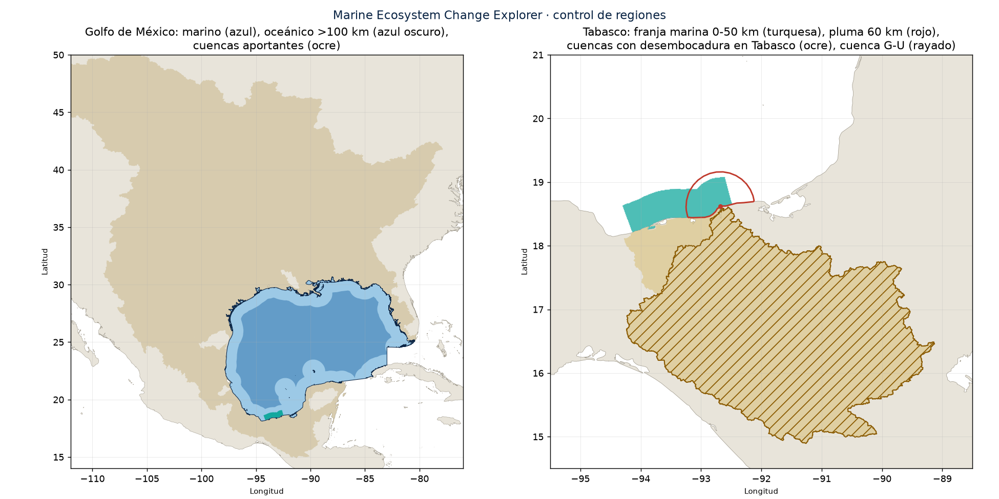

# Marine Ecosystem Change Explorer

Plataforma para monitorear, visualizar y analizar tendencias de ecosistemas marinos del **Golfo de México** con datos satelitales y modelos ambientales de NASA. Trabaja con clorofila‑a, temperatura superficial del mar, precipitación en las cuencas aportantes y, de forma complementaria, la hidrología terrestre.

Tiene dos módulos:
- **Monitor casi en tiempo real (NRT):** condiciones actuales y anomalías, siempre con la fecha real de observación.
- **Análisis histórico:** series desde 2003, anomalías, tendencias (OLS‑HAC, Mann‑Kendall estacional, Sen), mapas de tendencia con corrección FDR, correlaciones con desfase y reportes PDF/CSV por región.

> **Estado:** Fase 0 completada (configuración, acceso a NASA y regiones de estudio). El plan completo está en [`docs/`](docs/README.md).

## Inicio rápido
```bash
python3 -m venv .venv && source .venv/bin/activate
pip install -e ".[dev]"
cp .env.example .env && chmod 600 .env   # agregar EARTHDATA_TOKEN
mece check-config                        # valida config/*.yaml
mece check-access                        # prueba acceso real a cada producto NASA
mece regions build                       # (re)construye las regiones de estudio
pytest                                   # pruebas
```
Las reglas de trabajo en equipo están en [`docs/CONTRIBUTING.md`](docs/CONTRIBUTING.md).

## Regiones de estudio


## Fuentes de datos
NASA OB.DAAC (MODIS‑Aqua, PACE‑OCI), NASA PO.DAAC (GHRSST MUR25), NASA GES DISC (GPM IMERG, GLDAS). Los DOI y versiones están en [`docs/02_productos_datos.md`](docs/02_productos_datos.md).
