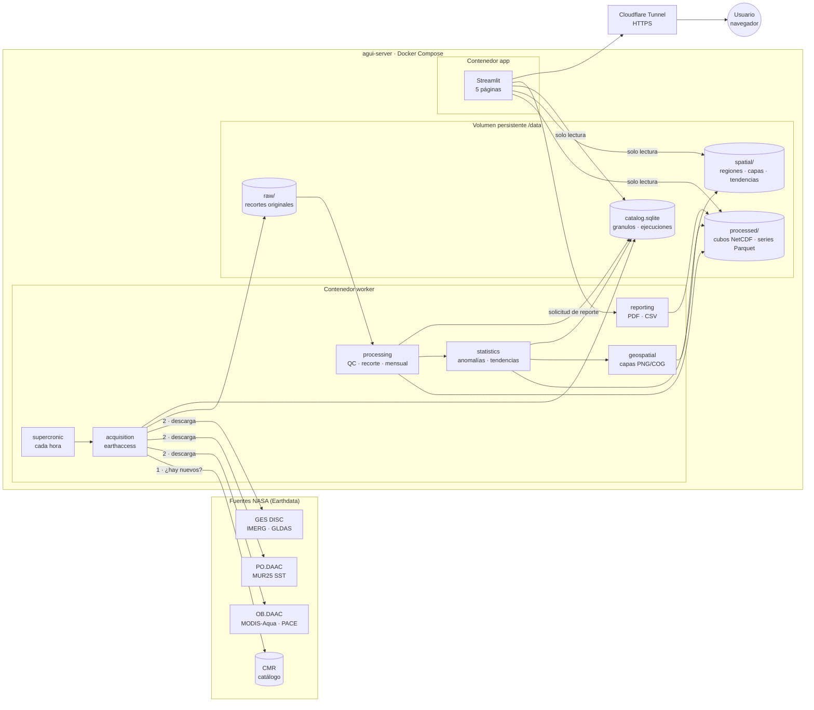
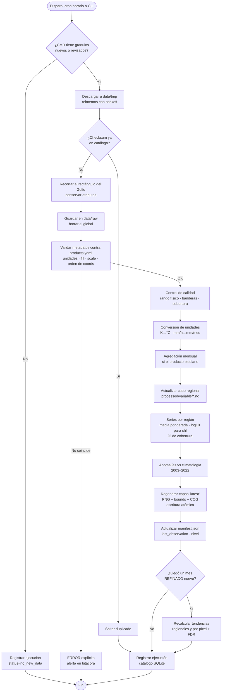

# 03 · Arquitectura, stack tecnológico y almacenamiento

## 1. Principios de diseño
1. **Dos procesos separados:**
   - El **worker** descarga, procesa y precalcula.
   - La **app** (dashboard) solo lee resultados ya calculados.

   Ninguna interacción del usuario dispara descargas masivas.
2. **Incremental e idempotente.** Volver a ejecutar el pipeline no duplica datos y procesa solo lo nuevo.
3. **Trazabilidad.** Cada número mostrado se puede rastrear hasta el granulo, la versión, la fecha de descarga y el método.
4. **Configuración declarativa.** Productos, regiones y parámetros estadísticos viven en YAML, no dentro del código.
5. **Ligereza.** Debe caber en unos 1.5 GB de RAM en un servidor compartido.

## 2. Stack tecnológico definitivo

| Capa | Herramienta | Para qué | Por qué esta y no otra |
|---|---|---|---|
| Lenguaje | **Python 3.12** | Todo el sistema | Ecosistema científico; ya instalado en el servidor |
| Acceso a datos | **earthaccess** | Login, búsqueda CMR y descarga de OB.DAAC, GES DISC y PO.DAAC | Oficial de NASA; un solo cliente para los 4 centros |
| Lectura de datos | **xarray + netCDF4 + h5netcdf** | Cubos etiquetados (time, lat, lon) | Estándar de facto; h5netcdf lee los grupos HDF5 de IMERG |
| Cálculo | **numpy, pandas, scipy** | Álgebra, series y estadística base | — |
| Geoespacial | **geopandas + shapely + regionmask** | Polígonos y máscaras de región sobre mallas xarray | `regionmask` hace en una línea lo que con rasterio requiere varios pasos |
| Exportación raster | **rioxarray** | GeoTIFF COG descargables | Solo se usa en exportación |
| Tendencias | **pymannkendall** | MK, MK estacional, Hamed‑Rao, Sen | Implementación revisada de las variantes que necesitamos |
| Regresión | **statsmodels** | OLS con errores HAC (Newey‑West), FDR (Benjamini‑Hochberg) | Intervalos de confianza correctos con autocorrelación |
| Gráficas interactivas | **Plotly** | Series, dispersión y correlogramas en el dashboard | Interactivo y se integra de forma nativa en Streamlit |
| Gráficas estáticas | **matplotlib + cmocean** | Figuras del PDF y PNG de capas del mapa | `cmocean` ofrece paletas oceanográficas perceptualmente uniformes |
| Mapa | **folium + streamlit‑folium** (Leaflet) | Mapa interactivo, capas y dibujo de polígonos (`Draw`) | Leaflet es ligero; folium ya trae el plugin de dibujo |
| Dashboard | **Streamlit** (multipágina, `st.navigation`) | Interfaz web | El equipo trabaja en Python sin frontend aparte |
| Reportes | **Jinja2 + WeasyPrint** | HTML → PDF con estilo | Las plantillas HTML/CSS se mantienen más fácil que ReportLab |
| Almacenamiento | **NetCDF4, Parquet (pyarrow) y SQLite** | Cubos, series y catálogo/bitácora | Sin servidor de BD; cero RAM extra |
| Configuración | **PyYAML + pydantic** | YAML validado con tipos | Detecta errores de configuración al arrancar |
| CLI | **Typer** | `mece ingest`, `mece process`, `mece trends`, `mece report` | Una sola puerta de entrada para el cron y para las personas |
| Programación | **supercronic** (cron para contenedores) | Ejecuta la CLI de forma periódica | Reemplaza a n8n; registra logs en stdout |
| Contenedores | **Docker Compose** | `app` + `worker` + volumen de datos | Docker ya está en el servidor; despliegue reproducible |
| Publicación | **Cloudflare Tunnel** (ya existe) | HTTPS público sin abrir puertos | Ya está operando en el servidor |
| Calidad de código | **pytest + ruff** + GitHub Actions | Pruebas y estilo en cada PR | Estándar y gratis |
| Exploración | **Jupyter / Google Colab** | Prototipos del equipo | Los notebooks importan el paquete `mece` en vez de copiar código |

**Descartadas o pospuestas:** n8n, PostgreSQL/PostGIS, Zarr, Dask y xESMF. Los motivos están en `01_evaluacion_viabilidad.md` §2.9. Resumen de Dask y xESMF: el volumen recortado cabe en memoria, y xESMF exige ESMF vía conda. Se reconsideran solo si una necesidad concreta lo justifica.

## 3. Diagrama de arquitectura del sistema



## 4. Diagrama de flujo de procesamiento



## 5. Estructura del repositorio

Se adapta la propuesta original. El código va bajo **`src/mece/`**: un paquete instalable con `pip install -e .`, de modo que los notebooks, la CLI y el dashboard importan el mismo código.

```
Nasa-compentency/                  ← raíz del repo
├── README.md                      instalación, uso y créditos de datos
├── pyproject.toml                 paquete + dependencias (fuente única)
├── requirements.txt               generado desde pyproject (Colab / Streamlit Cloud)
├── .env.example                   variables necesarias, sin valores
├── docker/
│   ├── Dockerfile                 imagen única para app y worker
│   ├── crontab                    horario de supercronic
│   └── docker-compose.yml
├── config/
│   ├── products.yaml              productos, versiones, variables, unidades, QC
│   ├── regions.yaml               pares marino/terrestre y sus GeoJSON
│   └── analysis.yaml              climatología, α, FDR, umbrales de cobertura
├── src/mece/
│   ├── config.py                  carga y valida YAML + .env
│   ├── catalog.py                 catálogo SQLite (granulos, ejecuciones)
│   ├── cli.py                     comandos Typer
│   ├── acquisition/               búsqueda CMR, descarga, recorte
│   ├── processing/                lectores por producto, QC, unidades, mensual
│   ├── geospatial/                regiones, máscaras, capas PNG/COG
│   ├── statistics/                descriptivos, anomalías, tendencias, correlaciones
│   ├── visualization/             paletas y figuras compartidas (Plotly/mpl)
│   └── reporting/                 plantillas Jinja2 y generación PDF/CSV
├── dashboard/
│   ├── app.py                     navegación y tema
│   ├── pages/                     01_monitor … 05_reportes
│   └── assets/                    CSS, logo
├── data/                          (fuera de Git salvo las regiones)
│   ├── raw/{chlorophyll,sst,precipitation,hydrology}/
│   ├── processed/{chlorophyll,sst,precipitation,hydrology}/
│   ├── spatial/{regions,layers,anomalies,trends}/
│   ├── reports/
│   ├── catalog/catalog.sqlite
│   └── tmp/
├── notebooks/                     NN_tema_autor.ipynb
├── tests/                         unitarias + validación vs pymannkendall/Giovanni
└── docs/                          este plan, decisiones, manuales
```

## 6. Esquema de almacenamiento

### 6.1 Convención de nombres de archivo
```
raw:        data/raw/<variable>/<product>_<version>_<YYYYMM[DD]>_<level>.nc
cubo:       data/processed/<variable>/<variable>_<product>_<version>_<freq>_gom.nc
series:     data/processed/<variable>/series_<variable>_<freq>.parquet
capas:      data/spatial/layers/<variable>_<kind>_<YYYYMM[DD]>.{png,json,tif}
tendencias: data/spatial/trends/<variable>_<method>_<start>_<end>.{nc,png,tif}
reportes:   data/reports/<region>_<vars>_<start>_<end>_<timestamp>.{pdf,zip}
```
- `variable` ∈ {chlorophyll, sst, precipitation, runoff}
- `level` ∈ {final, nrt, provisional}
- `kind` ∈ {value, anomaly}

### 6.2 Cubos NetCDF (processed)
- Un archivo por variable y producto, con dimensiones (`time`, `lat`, `lon`) sobre la **malla nativa** recortada.
- Variables: el valor, `n_valid_days` (si se compone a partir de diarios) y `level` (final/nrt).
- Atributos globales obligatorios: `source`, `product`, `version`, `doi`, `units`, `spatial_resolution`, `temporal_resolution`, `processing_method`, `created`, `mece_version`.

### 6.3 Series regionales (Parquet, formato largo)
| columna | tipo | descripción |
|---|---|---|
| region_id | str | `gom`, `tabasco_coast`, … |
| variable | str | chlorophyll, sst, … |
| product / version | str | trazabilidad |
| period | date | primer día del mes |
| level | str | final / nrt / provisional |
| value | float | media regional (geométrica para chl) |
| value_std, value_median, value_min, value_max | float | descriptivos espaciales |
| coverage | float | fracción de píxeles válidos (0–1) |
| anomaly | float | respecto a la climatología del mismo mes |
| anomaly_z | float | anomalía estandarizada |

### 6.4 Catálogo SQLite (`data/catalog/catalog.sqlite`)
```sql
CREATE TABLE granules (
  granule_id      TEXT PRIMARY KEY,   -- nombre del granulo en CMR
  concept_id      TEXT NOT NULL,
  variable        TEXT NOT NULL,
  product         TEXT NOT NULL,
  version         TEXT NOT NULL,
  level           TEXT NOT NULL CHECK (level IN ('final','nrt','provisional')),
  time_start      TEXT NOT NULL,      -- ISO 8601 UTC
  time_end        TEXT NOT NULL,
  cmr_revision    TEXT,               -- revision_date de CMR
  checksum        TEXT,
  raw_path        TEXT,
  downloaded_at   TEXT,
  processed_at    TEXT,
  status          TEXT NOT NULL       -- downloaded | processed | failed | superseded
);
CREATE TABLE runs (
  run_id       INTEGER PRIMARY KEY AUTOINCREMENT,
  started_at   TEXT NOT NULL,
  finished_at  TEXT,
  command      TEXT NOT NULL,         -- ingest | process | trends | report
  status       TEXT NOT NULL,         -- ok | no_new_data | partial | error
  n_new        INTEGER DEFAULT 0,
  message      TEXT
);
CREATE TABLE availability (           -- lo que el dashboard muestra como "estado"
  variable          TEXT, product TEXT, level TEXT,
  last_observation  TEXT,             -- time_end del granulo más reciente
  last_check        TEXT,
  last_ingest       TEXT,
  PRIMARY KEY (variable, product, level)
);
```

### 6.5 Capas de mapa
- `*_value_*.png` y `*_anomaly_*.png` son imágenes RGBA con paleta y rangos fijos definidos en `config/analysis.yaml`, para que dos fechas sean comparables visualmente.
- `*.json` guarda los bounds, la paleta, la unidad, la fecha de observación y el nivel. Leaflet lo usa para colocar la imagen y dibujar la leyenda.
- `*.tif` es un GeoTIFF COG para quien quiera descargar el dato.
- `data/spatial/layers/manifest.json` lista la última capa de cada variable. **Se escribe de forma atómica** (tmp + rename), así el dashboard nunca lee una capa a medio generar.

## 7. Estrategia de actualización automática del mapa
1. supercronic ejecuta `mece update` cada hora (minuto 17, para no coincidir con otros procesos).
2. `update` = `ingest` → `process` (solo periodos nuevos) → `layers` (solo variables con datos nuevos) → `manifest`.
3. El dashboard cachea con `st.cache_data`, usando como clave la marca de tiempo de `manifest.json`. Cuando el worker publica una capa nueva, la siguiente visita la ve sin reiniciar nada.
4. Las **tendencias** se recalculan solo si llega un mes **refinado** nuevo (unas 1–2 veces al mes) o por orden manual (`mece trends --force`).
5. Los fallos se reintentan 3 veces con espera exponencial y quedan registrados en `runs`. Un periodo sin datos (p. ej. un mes sin granulo) queda como hueco explícito, nunca se interpola.
6. Un archivo de bloqueo (`data/tmp/update.lock`) impide que dos ejecuciones se pisen.
