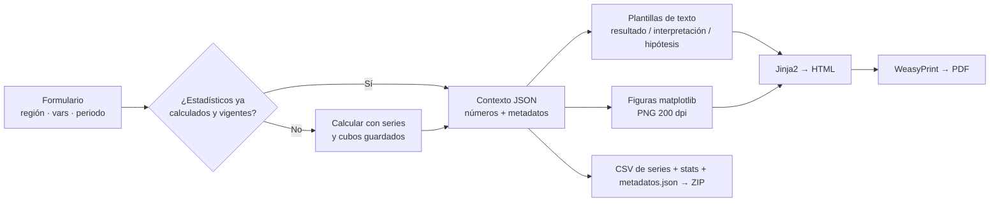

# 05 · Diseño funcional del dashboard y estrategia de reportes

## 1. Cambio propuesto a la estructura de páginas
La propuesta original tiene "Regional Explorer" como una página aparte. Pero la región afecta a **todas** las páginas. Por eso propongo:
- Poner el **selector de región como control global** en la barra lateral, junto con el periodo. Se conserva al cambiar de página.
- Convertir la página 4 en **"Comparar regiones"**: dos o tres regiones lado a lado y la tabla de tendencias de todas.

## 2. Estructura global

```
┌──────────────────────────────────────────────────────────────────────────────┐
│ ◉ MARINE ECOSYSTEM CHANGE EXPLORER                         [ES | EN]         │
│ CHL ● NRT 14‑nov‑2026   SST ● 13‑nov‑2026   PRECIP ● NRT 14‑nov · Final 09‑25│  ← barra de frescura
├───────────────┬──────────────────────────────────────────────────────────────┤
│ REGIÓN        │                                                              │
│ ▾ Golfo de    │                 CONTENIDO DE LA PÁGINA                       │
│   México      │                                                              │
│ PERIODO       │                                                              │
│ [2003]─[2025] │                                                              │
│ VARIABLE      │                                                              │
│ ○ Clorofila   │                                                              │
│ ● SST         │                                                              │
│ ○ Precip.     │                                                              │
│───────────────│                                                              │
│ 1 Monitor     │                                                              │
│ 2 Condiciones │                                                              │
│ 3 Tendencias  │                                                              │
│ 4 Comparar    │                                                              │
│ 5 Reportes    │                                                              │
│───────────────│                                                              │
│ Fuentes · Método · Acerca de                                                 │
└───────────────┴──────────────────────────────────────────────────────────────┘
```

**Barra de frescura:** un indicador por variable.
- Color: verde si el dato es reciente para su tipo de producto, ámbar si está retrasado y rojo si hubo un fallo.
- Muestra la **fecha de la última observación**, no la de actualización, y una etiqueta FINAL / NRT / PROVISIONAL.
- Al pasar el cursor aparecen `last_check`, `last_ingest`, el producto y la versión.

## 3. Páginas

### Página 1 · Monitor ambiental (NRT)
```
┌───────────────────────────────────────────┬──────────────────────────────┐
│                                           │ CONDICIONES ACTUALES (NRT)   │
│        MAPA (Leaflet)                     │ ┌──────────┐ ┌──────────┐    │
│  capas: ◉ Valor  ○ Anomalía               │ │ SST      │ │ CHL      │    │
│  variable: [SST ▾]  composición: [8 días] │ │ 27.8 °C  │ │ 0.21 mg  │    │
│  polígonos de regiones superpuestos       │ │ +0.9 °C  │ │ ×1.3     │    │
│  leyenda con unidad + fecha de obs.       │ │ inusual  │ │ normal   │    │
│                                           │ └──────────┘ └──────────┘    │
│                                           │ ┌──────────┐ ┌──────────┐    │
│                                           │ │ LLUVIA   │ │ ESTADO   │    │
│                                           │ │ 30 d     │ │ DATOS    │    │
│                                           │ │ 182 mm   │ │ 3/3 OK   │    │
│                                           │ │ 118 %    │ │          │    │
│                                           │ └──────────┘ └──────────┘    │
├───────────────────────────────────────────┴──────────────────────────────┤
│ ÚLTIMOS 90 DÍAS: serie diaria/8 días vs. banda climatológica p10–p90      │
├──────────────────────────────────────────────────────────────────────────┤
│ REGIONES CON MAYOR ANOMALÍA (|z|)  · tabla ordenada                       │
└──────────────────────────────────────────────────────────────────────────┘
```
- **Clorofila y SST:** composición móvil de 8 días, que se calcula a partir de los diarios NRT para reducir los huecos por nubes.
- **Precipitación:** acumulados de 1, 7 y 30 días, con IMERG Late.
- **Aviso fijo:** "Datos NRT: preliminares, sujetos a reprocesamiento."

### Página 2 · Condiciones oceánicas (histórico explorable)
- Mapa mensual con un **deslizador de mes** y capas de valor o anomalía.
- Al hacer clic en el mapa aparece la serie de ese píxel.
- Gráficas de la región: serie mensual con la climatología, matriz año × mes y boxplot por mes.
- Tabla de estadísticos descriptivos y botón para descargar la serie en CSV.

### Página 3 · Análisis de tendencias
```
┌─────────────────────────────────────────────────────────────────────────┐
│ VEREDICTO  ▲ Tendencia significativa creciente · +0.31 °C/década       │
│            IC95 % [0.22, 0.40] · MK estacional p<0.001 · 2003–2025      │
├─────────────────────────────────────┬───────────────────────────────────┤
│ Serie de anomalías + recta OLS      │ TABLA DE MÉTODOS                  │
│ + recta Sen + banda IC              │ OLS‑HAC  | β, IC, R², p           │
│                                     │ MK estac.| Z, τ, p                │
│                                     │ Hamed‑Rao| Z, p                   │
│                                     │ Sen      | pendiente, IC          │
│                                     │ r₁, n_eff, Ljung‑Box              │
├─────────────────────────────────────┴───────────────────────────────────┤
│ MAPA DE TENDENCIAS POR PÍXEL (FDR)   ▲ sig. ▼ sig. ░ no sig. ▒ insuf.   │
├─────────────────────────────────────────────────────────────────────────┤
│ ¿Qué significa esto?  (texto en tres capas: resultado / interpretación /│
│  hipótesis, desplegable)                                                 │
└─────────────────────────────────────────────────────────────────────────┘
```

### Página 4 · Comparar regiones y variables
- Selección de dos o tres regiones con sus tendencias lado a lado. Así se contesta "¿costa vs. océano?".
- **Relaciones entre variables:**
  - dispersión de anomalías;
  - correlograma cruzado de 0 a 6 meses con las barras significativas resaltadas;
  - tabla de Pearson y Spearman con IC y n_eff.
- Aviso fijo: "Correlación ≠ causalidad."
- **Fase posterior:** herramienta para dibujar un polígono propio en el mapa (plugin `Draw` de Leaflet). El polígono se analiza bajo demanda con los cubos ya guardados, sin descargar nada.

### Página 5 · Generador de reportes
- Formulario: región, variables, periodo e idioma.
- Botones **Generar PDF** y **Descargar CSV (ZIP)**.
- Historial de reportes generados.

## 4. Lenguaje visual
| Elemento | Decisión |
|---|---|
| Base | Azul marino `#0B2545` (encabezados y barra lateral), turquesa `#13A89E` (acentos y botones), blanco y gris claro `#F4F7FA` (fondo) |
| Clorofila | `cmocean.algae`, en escala log, de 0.01 a 30 mg m⁻³ |
| SST | `cmocean.thermal`, con un rango fijo para el Golfo |
| Precipitación | `cmocean.rain` |
| Anomalías | `cmocean.balance`, divergente y centrada en 0: cálidos para lo positivo y fríos para lo negativo. Para precipitación se invierte la convención (marrón seco, azul húmedo). |
| Tendencias | Divergente; lo no significativo con saturación reducida y punteado |
| Tipografía | Inter / Source Sans (la de Streamlit) y números tabulares en las tablas |
| Accesibilidad | Las paletas `cmocean` son perceptualmente uniformes y aptas para daltonismo. Nunca se comunica algo solo con el color: siempre van con ▲▼ y texto. |
| Idioma | **Bilingüe ES/EN** (D10): todos los textos viven en `dashboard/i18n/{es,en}.yaml` y las plantillas de reporte se generan en ambos idiomas |

## 5. Estrategia de generación de reportes

### 5.1 Flujo

- **No se usa un LLM para escribir conclusiones.** El texto sale de plantillas condicionadas a los resultados, para que el reporte no afirme nada que los números no respalden. Cada frase es trazable a un valor.
- El contexto JSON se guarda junto al PDF, así cada reporte es reproducible.

### 5.2 Índice del reporte
1. Portada: región, periodo, variables, fecha de generación y versión del software.
2. Descripción geográfica, con un mapa de los polígonos marino y terrestre.
3. Contexto ambiental, con texto fijo por región revisado por el equipo.
4. Datos utilizados: tabla de productos, versiones, DOI, resolución, cobertura real y % de meses válidos.
5. Series temporales y climatología.
6. Anomalías recientes y eventos extremos (|z| ≥ 2).
7. Tendencias: tabla de los métodos, veredicto, magnitud con IC y cambio total.
8. Mapa de tendencias por píxel con FDR.
9. Relación con otras variables: correlogramas y tabla.
10. Conclusiones, en las tres capas.
11. Limitaciones: textos fijos por variable más los avisos dinámicos (cobertura baja, periodo corto, NRT excluido, aguas complejas, etc.).
12. Anexo metodológico y referencias.
